# PracticeHUB V2 ERD

Request-led schema. Each request has exactly one eConsult in the validated dataset; the unique foreign key enforces at most one, and validation checks completeness.
Forecasts and model evaluations use result files, not database tables. Monthly KPIs are derived reporting data, not a transactional 3NF relation.

```mermaid
erDiagram
    direction LR
    patients {
        int patient_id PK
        string nhs_number_hash
        string sex
        date date_of_birth
        string age_band
        string postcode_district
        date registration_date
        int is_active
    }
    clinicians {
        int clinician_id PK
        string clinician_name
        string role
        float fte
        string working_pattern
        int usual_session_minutes
        int is_gp
        date active_from
        date active_to
    }
    practice_calendar {
        date calendar_date PK
        int is_open
        string closure_reason
        float seasonal_factor
    }
    clinician_absences {
        int absence_id PK
        int clinician_id FK
        date absence_date
        string absence_reason
    }
    clinicians ||--o{ clinician_absences : clinician_id
    clinic_sessions {
        int session_id PK
        int clinician_id FK
        date session_date
        string session_type
        string start_time
        string end_time
        int planned_slots
        int session_minutes
        string delivery_mode
    }
    clinicians ||--o{ clinic_sessions : clinician_id
    appointment_slots {
        int slot_id PK
        int session_id FK
        datetime slot_start_datetime
        datetime slot_end_datetime
        string slot_type
        string slot_status
        int is_bookable
    }
    clinic_sessions ||--o{ appointment_slots : session_id
    appointment_requests {
        int request_id PK
        int patient_id FK
        datetime requested_datetime
        string original_contact_channel
        string required_clinician_type
        string required_appointment_type
        datetime required_by_datetime
        string request_outcome
        string non_allocation_reason
        string external_care_status
        datetime external_appointment_datetime
    }
    patients ||--o{ appointment_requests : patient_id
    econsult_requests {
        int econsult_id PK
        int request_id FK
        int patient_id FK
        datetime submitted_datetime
        string original_contact_channel
        string submitted_by_role
        string category
        string urgency_level
        datetime triaged_datetime
        string triage_outcome
        int gp_appointment_recommended
        int resolved_without_appointment
        string signposting_reason
        string signposting_destination
    }
    patients ||--o{ econsult_requests : patient_id
    appointment_requests ||--o| econsult_requests : request_id
    appointments {
        int appointment_id PK
        int slot_id FK
        int patient_id FK
        int request_id FK
        datetime booked_datetime
        string booking_channel
        string appointment_reason
        string attendance_status
        string outcome
        int econsult_id FK
        datetime cancelled_datetime
    }
    econsult_requests ||--o| appointments : econsult_id
    appointment_requests ||--o| appointments : request_id
    patients ||--o{ appointments : patient_id
    appointment_slots ||--o| appointments : slot_id
    incoming_call_volumes {
        int incoming_call_volume_id PK
        date call_date
        int hour_start
        int calls_offered
        int calls_answered
        int calls_abandoned
        float average_wait_seconds
    }
    incoming_call_events {
        int incoming_call_event_id PK
        int incoming_call_volume_id FK
        int patient_id FK
        int request_id FK
        datetime call_datetime
        string queue_name
        string call_reason
        string call_outcome
        int wait_seconds
        int talk_seconds
        int booking_intent
        int appointment_booked
        string allocation_status_at_call
        string synthetic_call_reference
    }
    appointment_requests o|--o{ incoming_call_events : request_id
    patients o|--o{ incoming_call_events : patient_id
    incoming_call_volumes ||--o{ incoming_call_events : incoming_call_volume_id
    outgoing_call_attempts {
        int outgoing_call_attempt_id PK
        int patient_id FK
        int request_id FK
        int econsult_id FK
        int appointment_id FK
        datetime attempt_datetime
        int attempt_number
        string call_reason
        string call_outcome
        int appointment_booked_after_call
    }
    appointments o|--o{ outgoing_call_attempts : appointment_id
    econsult_requests ||--o{ outgoing_call_attempts : econsult_id
    appointment_requests ||--o{ outgoing_call_attempts : request_id
    patients ||--o{ outgoing_call_attempts : patient_id
    patient_complaints {
        int complaint_id PK
        int patient_id FK
        int request_id FK
        date complaint_date
        string complaint_category
        string complaint_trigger
        datetime trigger_datetime
        string complaint_text_summary
        int related_appointment_id FK
        int related_econsult_id FK
        string severity
        string status
    }
    econsult_requests ||--o{ patient_complaints : related_econsult_id
    appointments o|--o{ patient_complaints : related_appointment_id
    appointment_requests ||--o{ patient_complaints : request_id
    patients ||--o{ patient_complaints : patient_id
    appointment_activity_log {
        int appointment_activity_log_id PK
        int appointment_id FK
        datetime event_datetime
        string event_type
        string event_channel
        string event_actor
    }
    appointments ||--o{ appointment_activity_log : appointment_id
    request_activity_log {
        int request_activity_log_id PK
        int request_id FK
        datetime event_datetime
        string event_type
        string event_actor
        string event_payload
    }
    appointment_requests ||--o{ request_activity_log : request_id
    monthly_kpis {
        string kpi_month PK
        int registered_patients
        int gp_sessions
        int gp_slots_total
        int gp_slots_bookable
        int gp_slots_booked
        float gp_slot_utilisation_pct
        int appointments_attended
        int appointments_dna
        float dna_rate_pct
        int appointments_cancelled
        int econsult_requests
        int econsults_gp_recommended
        int econsults_resolved_without_appointment
        int incoming_calls_offered
        int incoming_calls_answered
        int incoming_calls_abandoned
        float incoming_call_answer_rate_pct
        float average_wait_seconds
        int outgoing_call_attempts
        int outgoing_calls_answered
        float outgoing_call_answer_rate_pct
        int appointments_booked_after_outgoing_call
        int access_complaints
        float access_complaints_per_1000_patients
        string synthetic_data_label
        int gp_requests
        int same_day_gp_requests
        int routine_gp_requests
        int capacity_diverted_requests
        int capacity_diverted_patients
        int unmet_gp_requests
        int patients_without_appointment
        int pending_gp_requests
        float gp_requests_allocated_on_time_pct
        int appropriate_signposted_requests
        int confirmed_external_bookings
        int morning_call_gp_requests
        int morning_call_unallocated_patients
        int econsult_online_unallocated_patients
        int same_day_capacity_diverted
        int routine_capacity_diverted
    }
```

